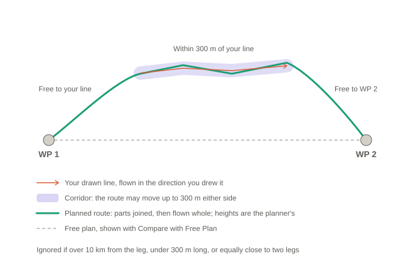
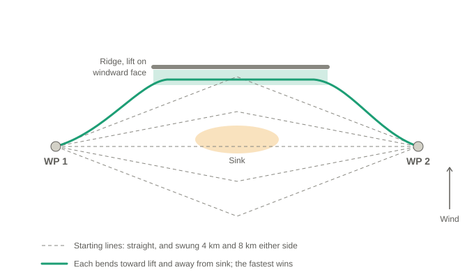
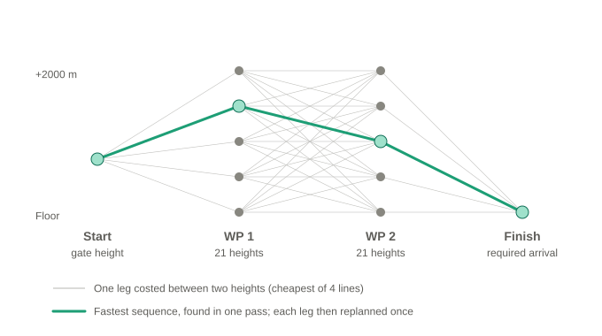
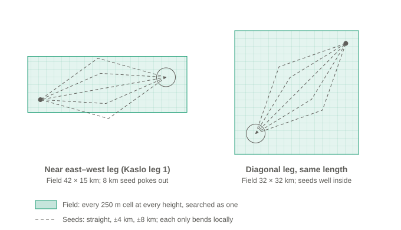

# Route planning: a quick guide

## What it does
Plan Route works out the fastest way round a task for your glider on the day's weather.
It mainly looks for lift you can use: ridge lift on the windward faces, and thermals where
it has to climb. It's best at choosing the route; treat its times as estimates.

## Before you plan
1. **Load the task:** File › Load Task Plan, then choose the task's .PLN.
2. **Weather:** the planner uses the task's weather preset (.WPR). If it can't find one, it
   asks you for it. The preset sets the wind and thermal strength the plan uses.
3. **Check the settings:**
   - **Glider:** the polar used, always at maximum weight.
   - **MacCready:** the climb rate you expect in thermals. A higher setting means faster
     cruising and less patience for weak lift.
   - **Resolution:** how finely each leg is shaped. Higher is more detailed but slower.
   - **CPU Use:** how much of the computer planning may take. The app stays usable while it runs.
4. **Optional: draw guide lines.** If you know a good ridge or line, draw it on the map. The
   planner then flies that part along your line. Turn on **Compare with Free Plan** to see
   whether your line is faster than the planner's own choice.
   - The line belongs to the leg it adds least distance to, and is flown in the direction
     you drew it.
   - The leg is flown in three parts: free to the start of your line, along it (the route
     may move up to 300 m either side), then free on to the next turnpoint. The parts are
     then joined and flown as one line. Your line sets the position only; the planner
     still chooses the heights and speeds.
   - Parts of a line inside a turnpoint cylinder are dropped, so a line through a
     cylinder becomes two lines.
   - A line is ignored if it is more than 10 km from the leg, shorter than 300 m, or about
     equally close to two legs. The status log counts the lines ignored and the Plan
     Summary says why.

   

## What happens when you press Plan Route
1. **Leg by leg:** the start is taken at the start gate's maximum height. Each leg aims to
   arrive at least 100 m above the terrain (or the turnpoint's minimum height). The next
   leg starts from there.
2. **Trying routes:** for each leg the planner lays out several candidate routes: straight,
   and swung 4 km and 8 km either side. It lets each one bend toward lift and away from sink.
   Each line only bends locally, so a ridge is found when some starting line passes near it.

   
3. **Costing them:** each candidate is timed, including any thermalling needed to keep
   enough height. The fastest wins. When two are close, it prefers the one that uses the ridges.
4. **Balancing the turnpoints:** it then chooses the height at each turnpoint. Sometimes
   arriving higher on one leg makes the next one quicker overall. Each leg is timed between
   every pair of candidate heights (every 100 m, up to 2,000 m above the floor). The fastest
   combination over the whole task is picked in one pass, and each leg is then planned once
   more at its chosen heights.

   

The status bar shows progress. Planning can take a few minutes.

## Reading the result
- **The route** is drawn on the map, leg by leg.
- **The status log line** gives the total task time and the glider. It also lists the legs
  that used your guide lines, how much faster or slower they were than the free plan, and
  how long planning took.
- **NOT FLYABLE** means at least one leg couldn't keep a safe height. Try another route, a
  guide line, or other settings.
- **Show Route Summary** gives leg-by-leg times, heights, thermalling and the route chosen.
- **Save Route / Load Route** keeps the plan, with its summary, to look at later.
- **Load IGC** overlays real flights, drawn from start to finish only, so you can compare
  them with the plan.

## Route profile
**File > Route > Show Profile** opens the plan's height profile, one leg at a time. Move the
mouse over it to see the point on the map.

- **✕ with a bold height:** a key crossing, at the height you want over it.
- **▲ with a height:** another crest or pass, on the ground, with the ground's height.
- Hover near one to read its details under the profile.

## Key crossings (✕)
An **✕ with a height** marks a ridge where your height decides whether the route works.
Most crests are not marked, only the two kinds where you commit:
- **Ridge exit:** the crest at the end of a sustained climb (300 m or more).
- **End of a long glide:** the crest at the end of a glide of 12 km or more over low ground.
  Once you've left the lift, the height you have is all you get.

**The number** is the height you want over the crest: the crest plus 100 m. It comes from
the terrain, so it holds on a weak day.

**Hover over the ✕** for the crest height and the plan's height there. On a long glide it
also shows the height the plan leaves the lift with, and how far back that is. That figure
relies on the plan's lift, so on a weak day allow more.

**How to use it:** if you're not going to make the number, don't start the crossing as
planned. Work the lift for longer, or pick another way round.

## Gap ahead
A **solid red card** under the node card, with a red **✕** on the map, warns of a pass you
have to cross to carry on with the route, when you're off the plan and too low for it from
where you are now. Get it wrong and you won't get through:

`GAP (8230) · 5.1 nm`
`Pass at 8560 · need +1200`

This is the lowest way through (its ground height), how far away it is, the height to pass
it at (100 m above that), and how much more height you need.

- **It uses where you actually are**, not the plan. The planner looks from your position
  towards the plan 15 km further on, and 3 km either side of that line.
- **It looks for a way on, not a way round:** the line it follows keeps moving forward, no
  more than 45° off the direction ahead, so it won't count going back round a ridge.
- **If the plan already knows the pass,** the card uses the plan's own heights: a gap within
  1.5 km of a key crossing, or of a crest or pass node ahead, takes that one's figures.
  Anything else, like a col the plan doesn't go near, uses the terrain's height + 100 m.
- **It only appears when you're off the plan:** 1,000 ft or more below the height to pass
  at, and either 500 ft or more below the plan's height here or over 1 km from its line.
  It goes again once you're within 500 ft of the pass height, and the ✕ goes with it.
- **It stays with you:** it follows the node card when you drag it, and keeps showing your
  own gap while you inspect another node.
- **It doesn't allow for the glide** to the gap, so you'll need a bit more than it says.
- **To try it out,** with the sim not connected, drop the what-if glider low in a valley
  on the plan. The check then uses the what-if glider's position and height.

**How to use it:** find the height before you go further in, or choose another way out
while you still can.

## Losing your lead
A **solid amber card** in the same place as the gap card warns that a height lead over the
plan is being spent with a pass still ahead:

`LOSING LEAD −620 in 3 min · now +690`
`Pass at 3200 in 5.1 nm`

Being above the plan looks safe until it's gone, and on a ridge it can go quickly, because
flying fast and high you may be missing the lift the plan expected.

- **It only works with the sim connected,** as it watches your lead over time.
- **It appears when:** you've lost 500 ft or more of lead in 3 minutes, you had at least
  800 ft of lead in that time, you've now got 1,000 ft or less, and a key crossing, crest
  or pass is within 15 km along the plan.
- **It goes when** the lead has held for a while, or there's no pass within 15 km. After
  that it won't come back for 5 minutes.
- **If it comes on:** slow to the plan's speed and get back into the ridge's lift band. Keep
  what's left until the pass is behind you.
- A gap warning takes priority and uses the same space.

## Thermal climbs
**What it means:** wherever the plan shows *thermal*, more height is needed to carry on
along the route.

**Why it appears:** when a leg can't be flown on glide and ridge lift alone, the planner
tops up the height with a thermal climb. Without it, the route would either fall below
100 m above the terrain, or arrive at the next turnpoint below the height it needs there.

**What it doesn't tell you:** where a thermal is. The planner doesn't know where real
thermals are. The climb marker only shows **the point by which the extra height is
needed**, and the Plan Summary shows how much.

**How to use it:** read a climb marker as *"I need this much more height by about here"*.
Look for lift before you reach it, whether that's a thermal, a ridge or straight-line lift
on the way.

## Things to know
- **Ridge lift is strongest low on the face.** It is full up to 150 m above the ground and
  fades out completely by 800 m. Plans often run quite low along ridges, as good pilots do.
  The plan never deliberately goes below about 100 m above the terrain.
- **It doesn't model** wave, or lift at height away from ridges and thermals. Assigned-area
  tasks can't be planned yet.
- **The planner can miss a good ridge** a few kilometres off its line when there's sink in
  between. If you know a better line, draw it as a guide line and compare.
- **Field Guides** (in the menu) is an experimental option that searches more widely for
  such lines. Leave it off for now: its times are still being checked. Instead of bending
  a few starting lines, it searches every 250 m cell at every height in a box round the
  leg (the turnpoint cylinders plus 3 km), and its best line then competes with the
  others. The box runs north–south and east–west, so its width depends on the leg's
  direction: about as wide as the 8 km lines at mid-leg on an east–west leg, much wider
  on a diagonal one.

  
- **Use the plan to pick the route.** Its times are a guide, not a promise.
